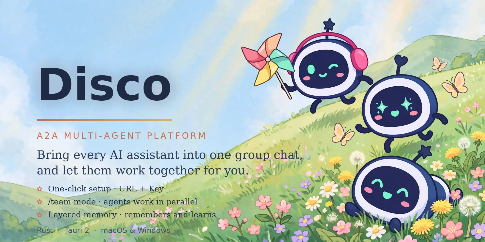
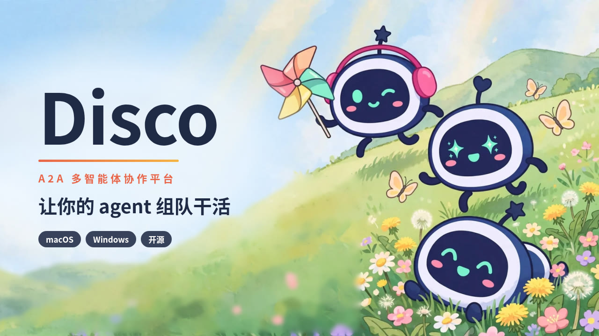

<p align="center"></p>

<p align="center">
  <b>让你的 agent 组队干活</b><br>
  本机的 Claude Code、Codex、Gemini、pi…… 和远程 A2A agent，拉进同一个群，单聊、接力、分工协作，并同步到 Discord。
</p>

<p align="center">
  <a href="https://github.com/Cosmoto-jian/disco-a2a/releases/latest"><b>⬇ 下载最新版</b></a> ·
  <a href="docs/getting-started.md">上手指南</a> ·
  <a href="#使用说明">▶ 观看演示</a>
</p>

## 为什么用 Disco

开着四个终端，Claude Code 修完 bug、你复制给 Codex review、再把结论贴给 Gemini…… 你成了 agent 之间的剪贴板。

Disco 把它们放进一个像微信一样的聊天窗口里：你 @ 谁，谁回答；它们之间也会互相 @、自动接力。你只管说要什么、批准关键操作。

## 特点

- **一个群，所有 agent**：本机任何支持 ACP 的 agent（Claude Code、Codex、Gemini CLI、Qwen Code、Goose、OpenCode、pi……）、远程 A2A agent、OpenAI 兼容接口，都能单聊或拉群。
- **和终端里一模一样**：直接驱动你自己装的 `claude` / `codex`，沿用同一个登录、同一个模型，不用再登录一次。
- **@ 接力**：`@名字` 指定谁回答，`@all` 一起回答；agent 回复里 @ 别人会自动接力，有轮数上限，不会无限循环。
- **团队模式**：群里发 `/team 任务`，组长拆分任务，成员在后台并行处理，产出写进群黑板，最后组长给出结论。
- **内置 Disco 工具（MCP）**：agent 可以主动发言、向别的 agent 请教（`ask`）、问你问题（`ask_user`）、维护待办和群文档、保存记忆、往共享空间放文件（`send_file`）。
- **待处理收件箱**：权限请求和 agent 的提问集中在一处，Disco 和 Discord 任一端点一下就算数，另一端自动同步。
- **Discord 镜像**：每个 agent 一个频道，群聊对应群频道；人在外面，用手机 Discord 就能指挥和批准。
- **分层记忆**：所有 agent / 本群 / 单个 agent 三层，按主题存成普通 Markdown 文件，只留在你自己的电脑上；每个对话可单独关掉记忆。
- **跨设备共享**：通过你自己的 Tailscale，用邀请码把 agent 共享给朋友或另一台电脑，可限额、可随时撤销。
- **轻量**：Rust + Tauri 2，原生窗口，内存占用小；应用内自动更新。

## 安装

前往 [Releases](https://github.com/Cosmoto-jian/disco-a2a/releases/latest) 下载：

| 系统 | 文件 | 说明 |
|---|---|---|
| macOS（Intel / Apple 芯片通用） | `Disco_x.y.z_universal.dmg` | 打开后把 Disco 拖进「应用程序」 |
| Windows 10 / 11（x64） | `Disco_x.y.z_x64-setup.exe` | 双击安装 |

**首次打开提示：**

- **macOS**：安装包为临时签名，第一次打开若提示「无法验证开发者」，在 Finder 里右键 Disco →「打开」→ 再点「打开」。仍打不开时，在终端运行：
  ```bash
  xattr -dr com.apple.quarantine /Applications/Disco.app
  ```
- **Windows**：若出现 SmartScreen 提示，点「更多信息」→「仍要运行」。

**前置条件：**

- 想用的 agent 先在终端里装好并登录过（例如 `claude`、`codex`、`gemini`）。Disco 会自动发现它们。
- 部分 agent 的 ACP 适配器需要 Node.js 18+。
- 可选：Discord 机器人（手机端指挥、群同步），Tailscale（跨设备共享）。

之后的版本会在应用内提示更新，一键完成。

## 使用说明

### 40 秒演示

<p align="center">
  <a href="docs/media/disco-promo.mp4"></a><br>
  <sub>点击封面播放（42 秒）</sub>
</p>

1. **导入 agent**：首次打开点「一键导入」，本机已安装的 agent 全部列出来，勾选即可。也可以手动添加 ACP 命令、远程 A2A 地址、OpenAI 兼容接口，或粘贴朋友的 `disco1:` 邀请码。
2. **私聊**：点开 agent 直接发消息，回复流式显示。说「记住 …」它会写进长期记忆。
3. **建群**：「群聊」→ 新建，勾选成员。在群里：

   | 写法 | 效果 |
   |---|---|
   | `@coder 帮我看下这个报错` | 只让 coder 回答 |
   | `@all 各自说说思路` | 所有成员一起回答 |
   | `@coder /review` | 调用该 agent 自带的斜杠命令 |
   | `/team 做一个登录页` | 团队模式：拆分、并行、汇总 |

4. **处理请求**：agent 要改文件、跑命令或有问题问你时，会出现在「待处理」，在 Disco 或 Discord 里批准 / 拒绝 / 回答。
5. **接上 Discord（可选）**：设置 → Discord，填入机器人 Token，点授权邀请进服务器，选主服务器即可同步频道。详细步骤见 [上手指南](docs/getting-started.md)。
6. **共享给朋友（可选）**：两台电脑在同一个 Tailscale 网络里，agent 菜单 →「共享给朋友…」，把生成的邀请码发给对方。
7. **紧急停止**：左下角状态键，点两下停止所有 agent。

快捷键：`⌘K` 搜索，`⌘1–4` 切换分栏，`⌘,` 打开设置（Windows 用 `Ctrl`）。

## 安全

- 密钥只存在系统凭据库里：macOS 钥匙串（一条钥匙串项，最多弹一次授权），Windows 凭据管理器。
- 共享只走你自己的 Tailscale：对方是哪台设备由 `tailscale whois` 确认，而不是对方自称；访问规则支持设备名、`tag:`、`user:`，拒绝优先，另有免打扰时段。
- 朋友的会话拿不到 Disco 工具，碰不到你的群、文档和记忆；需要批准的操作由你在本机决定。
- 所有操作写入审计日志。

## 从源码构建

需要 Rust（stable）和 Tauri 2 的系统依赖。

```bash
git clone https://github.com/Cosmoto-jian/disco-a2a.git
cd disco-a2a/crates/disco-app
cargo install tauri-cli --version "^2"
cargo tauri dev            # 开发运行
cargo tauri build          # 打包

# 在仓库根目录
cargo clippy -p disco-app -- -D warnings
cargo test --workspace
```

正式安装包由 GitHub Actions 打包：macOS universal `.dmg`（`macos-app.yml`），Windows x64 安装程序（`windows-app.yml`）。
